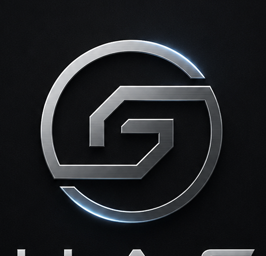
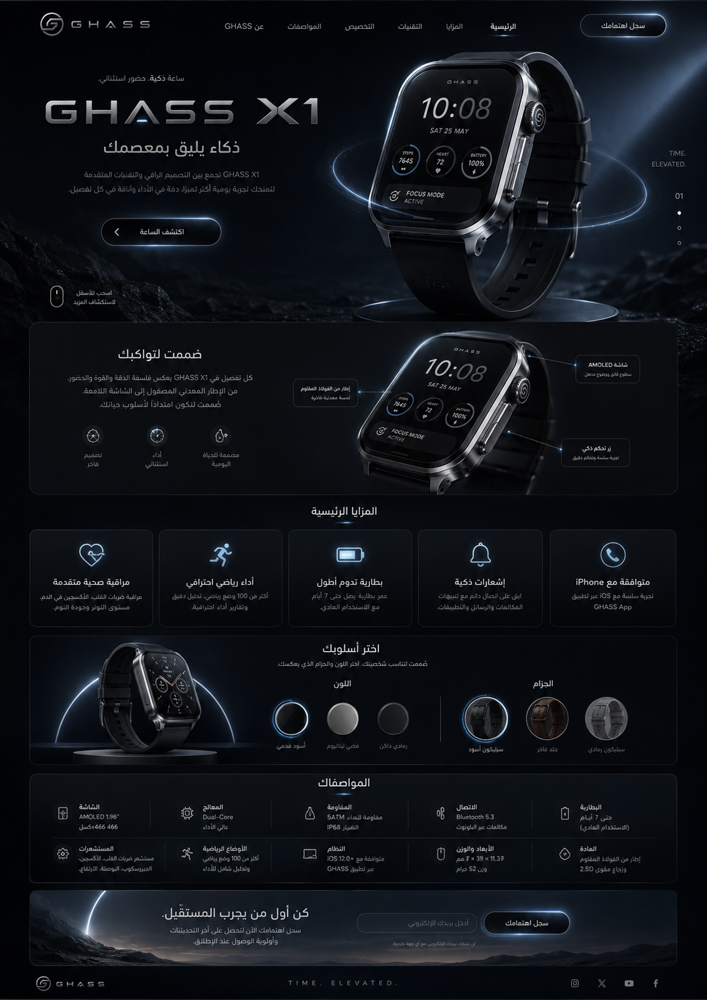

<div align="center">
  

  # GHASS X1

  **صفحة هبوط عربية تفاعلية لساعة ذكية فاخرة**

  تصميم مستقبلي داكن، تأثيرات حركية سلسة، وتجربة متجاوبة على الهاتف والكمبيوتر.
</div>



## نبذة عن المشروع

**GHASS X1** هو موقع تعريفي لعرض ساعة ذكية بهوية بصرية فاخرة وحديثة. يركز الموقع على تقديم المنتج بطريقة سينمائية وتفاعلية، دون إضافة متجر أو عملية شراء في المرحلة الحالية.

## المزايا

- واجهة عربية كاملة باتجاه `RTL`.
- تصميم متجاوب مع الكمبيوتر، الجهاز اللوحي والهاتف.
- حركات ظهور سلسة أثناء التمرير.
- تأثير Parallax وتفاعل بصري مع حركة المؤشر.
- قسم لعرض أهم خصائص الساعة.
- تخصيص تفاعلي للون الهيكل ونوع الحزام.
- نافذة عرض سينمائية للمنتج.
- نموذج تجريبي لتسجيل الاهتمام.
- تصميم خفيف يعمل باستخدام HTML وCSS وJavaScript فقط.

## التقنيات المستخدمة

- **HTML5** لبنية الصفحة.
- **CSS3** للتصميم، التجاوب والحركات.
- **Vanilla JavaScript** للتفاعلات والأنيميشن.
- **Google Fonts** لخطي Cairo وMontserrat.

## هيكل المشروع

```text
ghass-x1/
├── assets/
│   ├── ghass-logo.png
│   ├── ghass-mark.png
│   ├── ghass-watch.png
│   ├── ghass-watch-hero.png
│   └── ghass-x1-preview.png
├── index.html
├── styles.css
├── script.js
├── .nojekyll
└── README.md
```

## تشغيل المشروع محليًا

يمكن فتح ملف `index.html` مباشرة في المتصفح.

للحصول على تجربة أفضل، شغّل خادمًا محليًا داخل مجلد المشروع:

```bash
python3 -m http.server 8000
```

ثم افتح:

```text
http://localhost:8000
```


## التخصيص

- النصوص والمحتوى: `index.html`
- الألوان والتصميم والحركات: `styles.css`
- التفاعلات والسلوك البرمجي: `script.js`
- صور الساعة والشعار: مجلد `assets/`
.

## الحقوق

© 2026 GHASS. جميع الحقوق محفوظة.
